# Automotive Dual-Clutch Transmission (DCT) Concentric Shafts Fatigue Design
### *A Machine Element Design Case Study Using Westinghouse Criteria & SolidWorks*

[](LICENSE)
[](https://www.python.org/)
[](https://www.mathworks.com/products/matlab.html)
[](https://www.solidworks.com/)
[-brightgreen.svg)](#2-materials-operating-parameters--design-assumptions)
[](#2-materials-operating-parameters--design-assumptions)

This repository contains the comprehensive mechanical engineering design, static equilibrium analysis, stress concentration evaluation, and fatigue sizing for the concentric input shafts of a high-performance **5-speed wet dual-clutch transmission (DCT)**. 

The powertrain is energized by a **1.5L turbocharged engine** delivering **254 hp** and a peak torque of **390 N·m**. The dual-shaft architecture comprises:
1. **Shaft 1 (Inner Solid Shaft - "Red Shaft"):** Drives odd gears (1st, 3rd, and 5th), receiving torque via an involute spline from the primary wet clutch and transmitting power through Gear 1 ($G1$, $D = 150\text{ mm}$).
2. **Shaft 2 (Outer Hollow Shaft - "Green Shaft"):** Concentric outer sleeve driving even gears (2nd and 4th), receiving torque from the secondary wet clutch and driving Gear 2 ($G3$, $D = 250\text{ mm}$).

---

## Table of Contents
1. [Executive Summary & Powertrain Architecture](#1-executive-summary--powertrain-architecture)
2. [Materials, Operating Parameters & Design Assumptions](#2-materials-operating-parameters--design-assumptions)
3. [Static Equilibrium & 3D Load Distribution](#3-static-equilibrium--3d-load-distribution)
4. [Fatigue Analysis & Stress Concentration Modeling](#4-fatigue-analysis--stress-concentration-modeling)
   - [Marin Endurance Limit Modifications ($S_e$)](#marin-endurance-limit-modifications-s_e)
   - [Peterson Stress Concentration Factors ($K_t, K_{ts}, K_f, K_{fs}$)](#peterson-stress-concentration-factors-k_t-k_ts-k_f-k_fs)
5. [Shaft 1 (Inner Solid Shaft) Sizing](#5-shaft-1-inner-solid-shaft-sizing)
   - [Westinghouse Fatigue Equation](#westinghouse-fatigue-equation)
   - [Stepped Diameter Sizing & Standard Bearing Selection](#stepped-diameter-sizing--standard-bearing-selection)
   - [Secondary Loading Mode (Gear 2 Engagement)](#secondary-loading-mode-gear-2-engagement)
6. [Shaft 2 (Outer Hollow Shaft) Iterative Design](#6-shaft-2-outer-hollow-shaft-iterative-design)
   - [Hollow Shaft Modified Westinghouse Formulation](#hollow-shaft-modified-westinghouse-formulation)
   - [Trial-and-Error Convergence ($k = d_i / d_o$)](#trial-and-error-convergence-k--d_i--d_o)
7. [Keys, Retaining Snap Rings & Assembly Sequence](#7-keys-retaining-snap-rings--assembly-sequence)
8. [Manufacturing Drawings & ISO Tolerances](#8-manufacturing-drawings--iso-tolerances)
9. [Computational Solvers (Python & MATLAB)](#9-computational-solvers-python--matlab)
10. [Authors, Academic Information & References](#10-authors-academic-information--references)

---

## 1. Executive Summary & Powertrain Architecture

Modern automotive dual-clutch transmissions (DCT) eliminate the torque interruption inherent in traditional manual gearboxes by pre-selecting the next gear ratio on an idle shaft while power flows through the active clutch. 

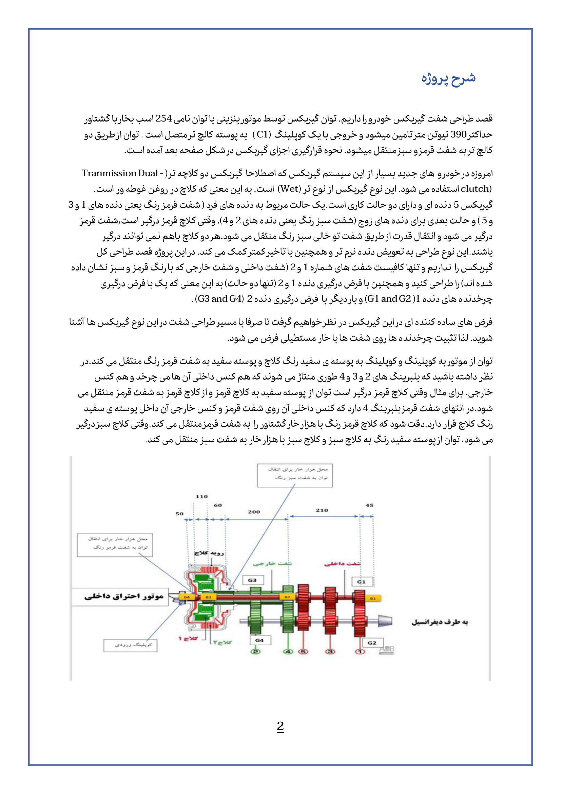
*Figure 1: Cross-sectional schematic of the 5-speed dual-clutch transmission showing the concentric solid inner shaft (red) and hollow outer shaft (green).*

- **Engine Source:** 1.5-liter turbocharged 4-cylinder engine.
- **Maximum Engine Torque:** $T_{\max} = 390.0\text{ N}\cdot\text{m}$.
- **Engine Rated Power:** $P = 254\text{ hp}$ ($189.4\text{ kW}$).
- **Gear Interaction:** 
  - *Mode 1 (1st Gear):* Primary clutch delivers $390\text{ N}\cdot\text{m}$ to Shaft 1, driving Gear 1 ($G1$, $D=150\text{ mm}$, width $25\text{ mm}$) mating with output gear $G2$ ($D=460\text{ mm}$).
  - *Mode 2 (2nd Gear):* Secondary clutch delivers $390\text{ N}\cdot\text{m}$ to Shaft 2, driving Gear 3 ($G3$, $D=250\text{ mm}$, width $20\text{ mm}$) mating with output gear $G4$ ($D=250\text{ mm}$).
  - During Mode 2, Shaft 1 acts as a dead rotating support shaft subjected to radial and moment loads transferred through intermediate bearings $B_2$ and $B_3$.

---

## 2. Materials, Operating Parameters & Design Assumptions

| Component | Material Specification | $S_{ut}$ (MPa) | $S_y$ (MPa) | Manufacturing / Heat Treatment |
| :--- | :--- | :---: | :---: | :--- |
| **Shaft 1 (Solid)** | **AISI 1045 Hot-Rolled (HR)** | $570.0$ | $310.0$ | Lathe turned and ground finish |
| **Shaft 2 (Hollow)** | **AISI 1045 Hot-Rolled (HR)** | $570.0$ | $310.0$ | Lathe turned and ground finish |
| **Drive Keys** | **AISI 1020 Cold-Drawn (CD)** | $1020.0$ | $848.0$ | End-milled keyways, press-fit |

### Design Assumptions:
1. **Design Safety Factor ($FS$):** $FS = 3.0$ for both shafts and keys to safely absorb heavy dynamic shock loads and torsional torque reversals.
2. **Target Reliability:** $99.99\%$ ($k_e = 0.702$, transformation variate $z_a = 3.719$).
3. **Gear Pressure Angle ($\phi$):** Standard $20.0^\circ$ full-depth involute tooth profile.
4. **Surface Finish:** Fine cylindrical ground finish ($a = 1.58, b = -0.085$).
5. **Operating Temperature:** Below $200^\circ\text{C}$ in synthetic wet-clutch automatic transmission fluid ($k_d = 1.0$).

---

## 3. Static Equilibrium & 3D Load Distribution

### Gear Forces (1st Gear Mode, Gear G1):
The pitch diameter of Gear 1 is $D_1 = 150\text{ mm}$ ($r_{g1} = 0.075\text{ m}$):
- **Tangential Force:**
  $$W_t = \frac{T}{r_{g1}} = \frac{390.0}{0.075} = \mathbf{5200.0\text{ N}}$$
- **Radial Separating Force:**
  $$W_r = W_t \tan(\phi) = 5200.0 \times \tan(20^\circ) = \mathbf{1892.6\text{ N}}$$

### Bearing Reaction Loads:
The bearing support span between rear bearing $B_4$ ($x = 0\text{ m}$) and front bearing $B_1$ ($x = 0.675\text{ m}$), with Gear 1 located at $x = 0.630\text{ m}$:
- **Vertical Plane ($xy$):**
  $$\sum M_{B4} = 0 \implies W_r (0.630) - B_{1,xy} (0.675) = 0 \implies B_{1,xy} = \mathbf{1766.46\text{ N}}, \quad B_{4,xy} = \mathbf{126.17\text{ N}}$$
- **Horizontal Plane ($xz$):**
  $$\sum M_{B4} = 0 \implies W_t (0.630) - B_{1,xz} (0.675) = 0 \implies B_{1,xz} = \mathbf{4853.33\text{ N}}, \quad B_{4,xz} = \mathbf{346.67\text{ N}}$$

| Shear & Moment Diagram (Vertical $xy$) | Shear & Moment Diagram (Horizontal $xz$) |
| :---: | :---: |
| 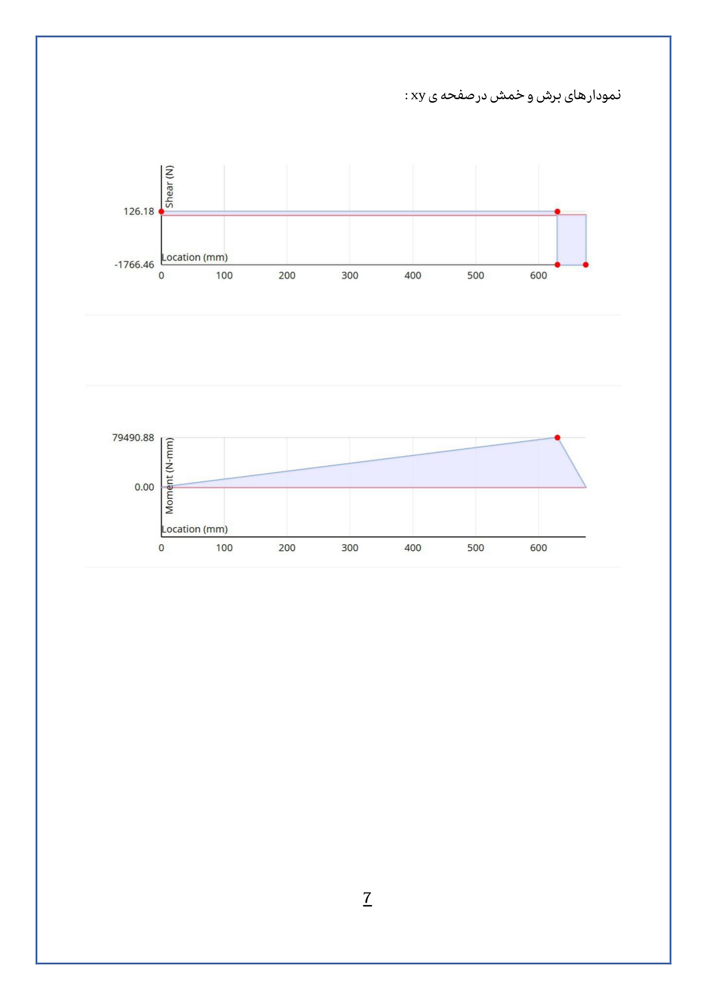 | 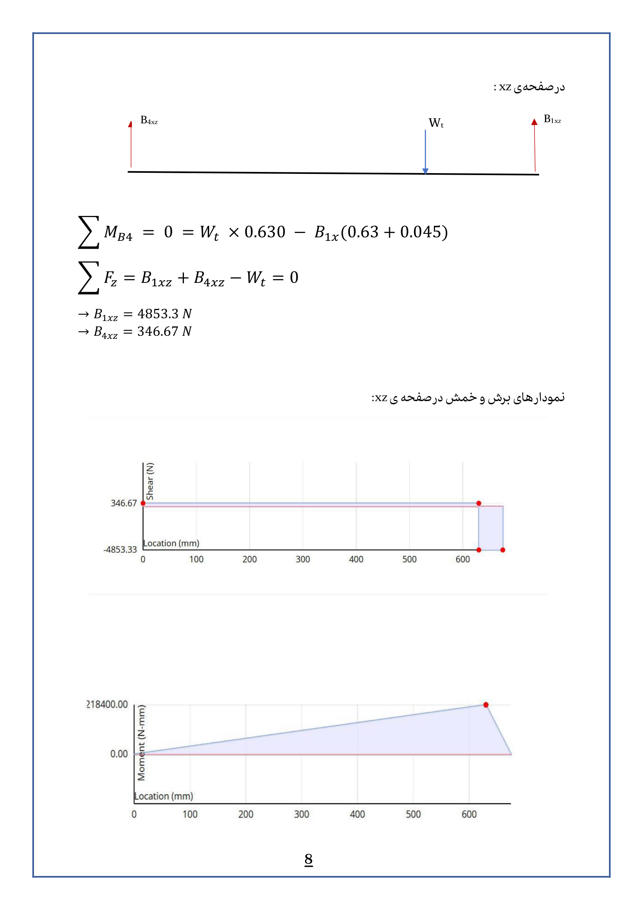 |

<p align="center">
  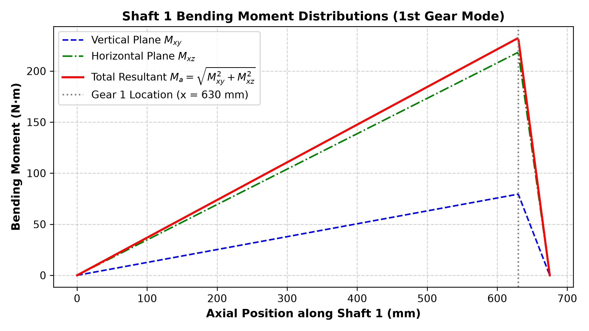
  <br /><em>Figure 2: Resultant alternating bending moment distribution along Shaft 1 reaching a maximum of 232.4 N·m at the gear keyway.</em>
</p>

---

## 4. Fatigue Analysis & Stress Concentration Modeling

### Marin Endurance Limit Modifications ($S_e$)
The laboratory rotary-beam specimen endurance limit for AISI 1045 steel is:
$$S_e' = 0.504 S_{ut} = 0.504 \times 570.0 = 285.0\text{ MPa}$$

Applying Marin's empirical modification factors:
- **Surface Condition Factor ($k_a$):** Ground finish:
  $$k_a = a S_{ut}^b = 1.58 \times (570.0)^{-0.085} \approx \mathbf{0.9213}$$
- **Size Factor ($k_b$):** For initial trial diameter $d \approx 50\text{ mm}$:
  $$k_b = 1.24 d^{-0.107} = 1.24 \times (50.0)^{-0.107} \approx \mathbf{0.8159}$$
- **Load Factor ($k_c$):** Bending load $k_c = 1.0$.
- **Temperature Factor ($k_d$):** Operating in oil bath $< 200^\circ\text{C}$, $k_d = 1.0$.
- **Reliability Factor ($k_e$):** For $99.99\%$ target reliability ($z_a = 3.719$):
  $$k_e = \mathbf{0.702}$$
- **Miscellaneous Factor ($k_f$):** $k_f = 1.0$.

$$\mathbf{S_e} = k_a k_b k_c k_d k_e k_f S_e' = 0.9213 \times 0.8159 \times 1.0 \times 1.0 \times 0.702 \times 1.0 \times 285.0 \approx \mathbf{150.39\text{ MPa}}$$

### Peterson Stress Concentration Factors ($K_t, K_{ts}, K_f, K_{fs}$)
- **Stepped Shaft Shoulders ($D/d = 1.2, r/d = 0.03$):**
  $$K_t = 2.3, \quad K_{ts} = 1.7$$
  $$q = 0.75, \quad q_s = 0.85 \implies K_f = 1 + 0.75(2.3 - 1) = \mathbf{1.975}, \quad K_{fs} = 1 + 0.85(1.7 - 1) = \mathbf{1.595}$$
- **Snap Ring Retaining Grooves:**
  $$K_t = 2.8, \quad K_{ts} = 1.7 \implies K_f = \mathbf{2.35}, \quad K_{fs} = \mathbf{1.595}$$
- **End-Milled Profile Keyways (Shigley Table):**
  $$K_f = \mathbf{1.30}, \quad K_{fs} = \mathbf{1.30}$$

---

## 5. Shaft 1 (Inner Solid Shaft) Sizing

### Westinghouse Fatigue Equation
Under rotating bending and fluctuating torsion, the alternating bending moment is $M_a = \sqrt{M_{xy}^2 + M_{xz}^2}$ and mean bending is $M_m = 0$. Torsion fluctuates between $0$ and $390\text{ N}\cdot\text{m}$, yielding $T_m = T_a = 195.0\text{ N}\cdot\text{m}$.

The required shaft diameter $d$ is given by the Westinghouse fatigue criterion:
$$d = \left[ \frac{32 \cdot FS}{\pi} \sqrt{ K_f^2 \left( \frac{M_m}{S_y} + \frac{M_a}{S_e} \right)^2 + K_{fs}^2 \left( \frac{T_m}{S_y} + \frac{T_a}{S_e} \right)^2 } \right]^{1/3}$$

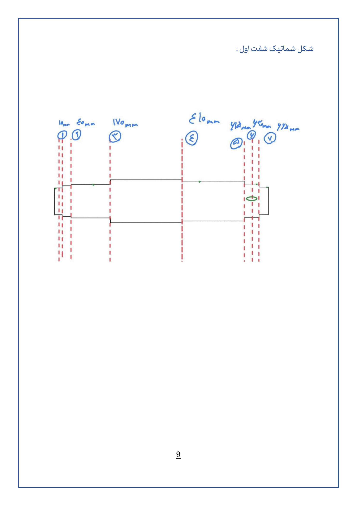
*Figure 3: Identification of critical stress concentration sections 1 to 7 along Shaft 1.*

### Stepped Diameter Sizing & Standard Bearing Selection

| Section ID | Location Description | Position $x$ (mm) | Alternating Moment $M_a$ (N·m) | Stress Factor $K_f / K_{fs}$ | Calculated Min. $d_1$ (mm) | Selected Standard Diameter $d_2$ (mm) | Selected Standard Component |
| :---: | :--- | :---: | :---: | :---: | :---: | :---: | :--- |
| **1** | Bearing $B_4$ Seat | $10$ | $3.69$ | $1.975 / 1.595$ | $11.40$ | **$45.0$** | Deep Groove Ball Bearing 6009 |
| **2** | Primary Clutch Spline | $40$ | $14.76$ | $1.975 / 1.595$ | $45.48$ | **$48.0$** | Involute Spline Seat |
| **3** | Bearing $B_3$ Seat | $170$ | $62.71$ | $1.975 / 1.595$ | $45.97$ | **$55.0$** | Deep Groove Ball Bearing 6011 |
| **4** | Bearing $B_2$ Seat | $410$ | $155.38$ | $1.975 / 1.595$ | $48.30$ | **$55.0$** | Deep Groove Ball Bearing 6011 |
| **5** | Gear $G_1$ Locating Shoulder | $615$ | $227.05$ | $1.975 / 1.595$ | $50.76$ | **$68.0$** | Axial Locating Step Shoulder |
| **6** | Gear $G_1$ Keyway Seat | $630$ | $232.42$ | $1.300 / 1.300$ | $39.45$ | **$52.0$** | Rectangular Key Seat ($16 \times 10$) |
| **7** | Bearing $B_1$ Seat | $665$ | $50.14$ | $1.975 / 1.595$ | $27.20$ | **$45.0$** | Deep Groove Ball Bearing 6009 |

<p align="center">
  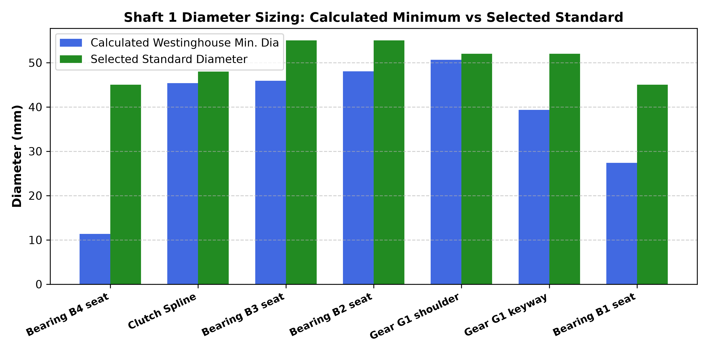
  <br /><em>Figure 4: Calculated minimum diameter vs selected standardized diameter across Shaft 1 sections.</em>
</p>

### Secondary Loading Mode (Gear 2 Engagement)
When the transmission shifts into 2nd gear, power is delivered through the outer hollow shaft (Shaft 2) with Gear 3 ($W_t = 3120\text{ N}, W_r = 1135.6\text{ N}$). The reaction loads at intermediate bearings $B_2$ and $B_3$ act on Shaft 1 as static beam loads ($M_a = 0, M_m = \text{static moment}$). Re-evaluating Westinghouse equations confirms that the chosen diameters provide a safety factor strictly exceeding $FS > 3.25$.

---

## 6. Shaft 2 (Outer Hollow Shaft) Iterative Design

### Hollow Shaft Modified Westinghouse Formulation
For the hollow sleeve shaft with inside diameter $d_i$ and outside diameter $d_o$, the diameter ratio is defined as $k = \frac{d_i}{d_o}$:

$$d_o = \left[ \frac{32 \cdot FS}{\pi (1 - k^4)} \sqrt{ K_f^2 \left( \frac{M_a}{S_e} + \frac{M_m}{S_y} \right)^2 + K_{fs}^2 \left( \frac{T_m}{S_y} + \frac{T_a}{S_e} \right)^2 } \right]^{1/3}$$

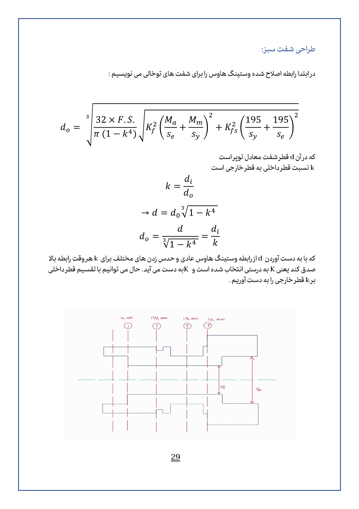
*Figure 5: Stepped hollow shaft architecture housing internal bearings $B_2$ and $B_3$.*

### Trial-and-Error Convergence ($k = d_i / d_o$)
Because internal bearings $B_2$ and $B_3$ (bore $55\text{ mm}$, outer diameter $90\text{ mm}$) are mounted directly inside the hollow shaft, the inner bore is constrained to $d_i = 86.0\text{ mm}$ (clearance zone) and $90.0\text{ mm}$ (bearing seats):

```text
Iterative Trial-and-Error Convergence (Critical Section, di = 86.0 mm):
----------------------------------------------------------------------
k_assumed = 0.9000  -->  do_calc =  66.27 mm  -->  k_real = 1.298  (Unconverged)
k_assumed = 0.9400  -->  do_calc =  77.00 mm  -->  k_real = 1.117  (Unconverged)
k_assumed = 0.9600  -->  do_calc =  87.26 mm  -->  k_real = 0.986  (Close)
k_assumed = 0.9743  -->  do_calc = 100.40 mm  -->  k_real = 0.857  (Structural Minimum)
```

Factoring in a minimum $8.0\text{ mm}$ keyway depth and standard structural tube thickness:
- **Bearing Seat Outer Diameter:** $\mathbf{110.0\text{ mm}}$ ($s6/h7$ fit).
- **Gear $G_3$ Mounting Step Outer Diameter:** $\mathbf{118.0\text{ mm}}$ ($p6/h7$ interference fit).

---

## 7. Keys, Retaining Snap Rings & Assembly Sequence

### Rectangular Key Sizing:
Both gear connections use square/rectangular parallel driving keys made from cold-drawn AISI 1020 steel ($S_{y, \text{key}} = 848\text{ MPa}$):

$$L_{\min} = \frac{4 T \cdot FS}{d \cdot h \cdot S_y}$$

1. **Shaft 1 (Gear $G_1$, $d = 52\text{ mm}$):**
   - Standard key size: $16 \times 10\text{ mm}$ ($b \times h$).
   - Calculated minimum length: $L_{\min} = \frac{4 \times 390 \times 3}{0.052 \times 0.010 \times 848 \times 10^6} \approx \mathbf{29.0\text{ mm}}$.
   - **Selected Design Length:** $L = \mathbf{40.0\text{ mm}}$ with an auxiliary $40\text{ mm}$ wide spacer bushing under the gear for smooth torque transmission.
2. **Shaft 2 (Gear $G_3$, $d = 110\text{ mm}$):**
   - Standard key size: $28 \times 16\text{ mm}$.
   - Calculated minimum length: $L_{\min} = \frac{4 \times 390 \times 3}{0.110 \times 0.016 \times 848 \times 10^6} \approx \mathbf{8.57\text{ mm}}$.
   - **Selected Design Length:** $L = \mathbf{20.0\text{ mm}}$.

### Assembly Procedure:
1. **Shaft 1 Assembly (Right to Left):**
   - Bearing $B_2$ is press-fit onto the $55\text{ mm}$ seat; retaining snap ring is installed.
   - Rectangular key ($16 \times 10 \times 40\text{ mm}$) and spacer bushing are positioned; Gear 1 ($G1$) is mounted.
   - Retaining snap ring for Gear 1 is seated to lock axial movement.
   - Bearing $B_1$ is press-fit on the $45\text{ mm}$ journal and retained by snap ring.
2. **Shaft 2 Assembly:**
   - Hollow Shaft 2 is slid over Shaft 1 from the left, seating onto the outer race of Bearing $B_2$.
   - Bearing $B_3$ is inserted and locked with internal snap rings.
   - Key ($28 \times 16 \times 20\text{ mm}$) and Gear 3 are assembled on the $110\text{ mm}$ journal.
   - Retaining snap ring is installed, securing the concentric powertrain assembly.

---

## 8. Manufacturing Drawings & ISO Tolerances

Full production drawings have been detailed according to ISO standard fits:

| Shaft 1 (Inner Solid Shaft) 2D Drawing | Shaft 2 (Outer Hollow Shaft) 2D Drawing |
| :---: | :---: |
| 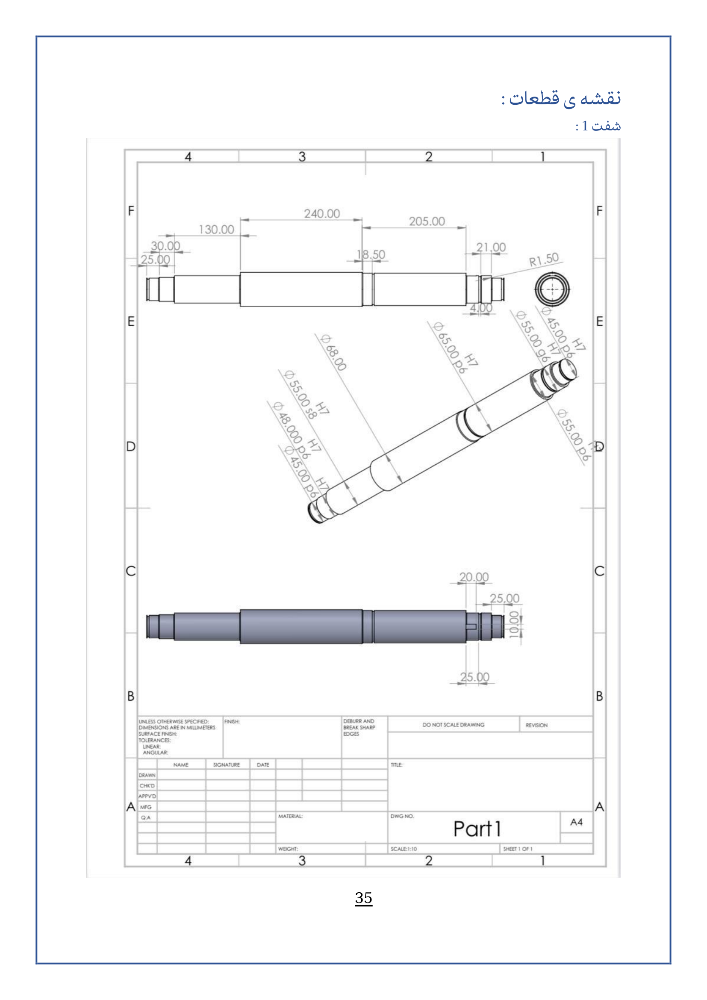 | 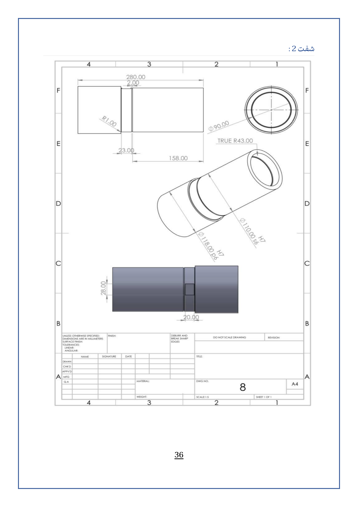 |

| Shaft 1 3D CAD Isometric | Shaft 2 3D CAD Isometric |
| :---: | :---: |
| 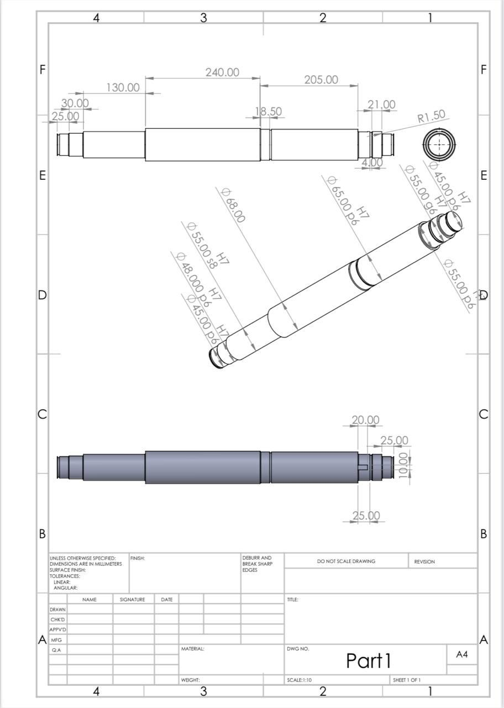 | 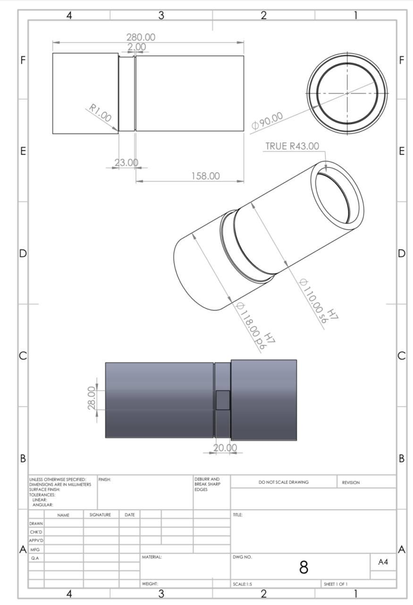 |

### Key Tolerance Fits:
- **Bearing Journals:** $\phi 45\text{ }p6/h7$, $\phi 55\text{ }p6/h7$, $\phi 65\text{ }p6/h7$ (Transition/interference fit for rotating inner rings).
- **Gear Keyway Journals:** $\phi 52\text{ }h7$, $\phi 110\text{ }s6/h7$.
- **Hollow Shaft Outer Step:** $\phi 118\text{ }p6$.

---

## 9. Computational Solvers (Python & MATLAB)

The repository provides automated design solvers in both Python and MATLAB:

### Running the Python Engine:
```bash
# Navigate to the project directory
cd shaft

# Run fatigue sizing and generate moment plots
python src/shaft_design_solver.py
```
Outputs Westinghouse minimum diameters, verifies hollow shaft trial-and-error convergence, and exports high-DPI plots into `docs/images/`.

### Running in MATLAB:
```matlab
cd src
shaft_design_solver
```

---

## 10. Authors, Academic Information & References

- **Authors:** 
  - **Zahra Khazaei** — Department of Mechanical Engineering, Sharif University of Technology
  - **Arshia Edalatpajouh** — Department of Mechanical Engineering, Sharif University of Technology (Student ID: 402110651)
- **Course Instructor:** Dr. Keyvan Mohammadi
- **Course:** Machine Elements Design 1 (طراحی اجزاء ماشین ۱), Fall 1404 (Late 2025)

### References & Standards
1. Budynas, R. G., & Nisbett, J. K. *Shigley's Mechanical Engineering Design*, 11th Edition, McGraw-Hill.
2. Peterson, R. E. *Stress Concentration Design Factors*, John Wiley & Sons.
3. SKF General Catalogue & Engineering Calculator for Rolling Bearings ([www.skf.com](https://www.skf.com/)).
4. DIN 6885 / ISO 773 Standards for Drive Keys and Keyways.
